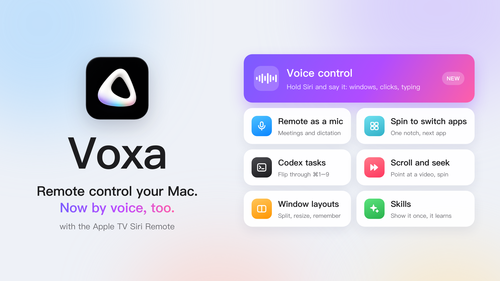

**English** | [简体中文](./README.zh-CN.md)

# Voxa — Remote control your Mac, by voice too

Turn the **Apple TV Siri Remote** into a remote control for your Mac. 
Press, swipe, spin the ring — or **hold the Siri button and just say what you want**.

**[Download Voxa for Mac (.dmg)](https://github.com/jinzongma/voxa/releases/latest)** · [Website](https://voxa.saitosun.cn) · [User guide](./VOXA-User-Guide.md)

**Voxa** is a macOS app that lets you **remote control your Mac with an Apple TV Siri Remote** — and **control your
Mac by voice** through the remote's microphone. Pair the remote in Bluetooth settings and you're set: no Apple TV needed.

## Voice control

Hold the Siri button, say it, let go. Voxa does it on your Mac:

| Say (in Chinese) | What Voxa does |
| --- | --- |
| “把微信和备忘录左右分屏” | Puts WeChat and Notes side by side |
| “记住这个布局，叫写作” | Saves these windows as a layout named “Writing” to bring back later |
| “点一下发送” | Clicks the button named Send |
| “提醒我今晚八点给妈妈打电话” | Adds a reminder for 8 pm |
| “明天下午三点开会，加到日历” | Adds a calendar event |
| “给张三发微信说晚点到” | Sends a WeChat message |
| “截个图” · “声音小一点” | Takes a screenshot · lowers the volume |

- **Several steps in one sentence** — Voxa breaks it down and runs them in order.
- **Types for you** — dictate straight into any text field.
- **Skills** — show Voxa a task once, then run it again with one sentence.

> Voice control is part of **Voice Pro** (one-time purchase). It currently works when Voxa's language is set to
> Simplified Chinese, and needs macOS 14 Sonoma or later. Speech is recognized on your Mac.

## Remote control (free)

- **Button mapping** — turn any Siri Remote button into a key, a keyboard shortcut or a common action.
- **App scenes** — a different mapping for each app, switched automatically when that app comes to the front
  (e.g. next slide in Keynote, play/pause in your video player).
- **Clickpad as a trackpad** — move the pointer and click from the couch.
- **Spin the ring to switch apps** — one notch, next app.
- **Shortcuts** — browse and run macOS Shortcuts from the remote.
- **Hold mode** — hold the Siri button and the mapped key stays held: works with hold-to-talk dictation tools.
- **Launch at login** — the remote works as soon as your Mac starts, quietly from the menu bar.

## Also in Voice Pro

- **Siri Remote as a Mac microphone** — a compatible remote shows up as **Voxa Microphone**, usable in meetings,
  voice input methods and recording apps.
- **More ring actions** — scroll pages, switch Codex tasks (⌘1–9), and seek videos when the pointer is over a video.

## Download

**[Download the latest Voxa (.dmg)](https://github.com/jinzongma/voxa/releases/latest)**

- Apple Silicon Mac (M1 or later)
- macOS 13 Ventura or later (voice control needs macOS 14 Sonoma or later)
- An Apple TV Siri Remote paired in System Settings › Bluetooth
- Developer ID signed and notarized by Apple

Step-by-step setup: [Installation & User Guide](./VOXA-User-Guide.md).

## Preview

### Remote mapping

### Custom button mapping

### App scenes

## FAQ

**Can I control my Mac by voice with the Siri Remote?**
Yes, with Voice Pro: hold the Siri button and speak. Voice control currently works with Voxa set to Simplified Chinese
and needs macOS 14 or later.

**Can I use an Apple TV Siri Remote with my Mac?**
Yes. Pair it in System Settings › Bluetooth, then Voxa turns its buttons, clickpad and ring into Mac controls.
You don't need an Apple TV.

**Can the Siri Remote work as a presentation remote for Keynote or PowerPoint?**
Yes. Map buttons or the ring to next/previous slide; with app scenes the mapping switches automatically while your
presentation app is in front.

**Can I use the Siri Remote's microphone on a Mac?**
With Voice Pro, a compatible Siri Remote becomes a Mac input device called **Voxa Microphone** that any app can select.

**Does Voxa run on Intel Macs?**
No. Voxa is built for Apple Silicon Macs only.

**Is Voxa a subscription?**
No. The remote features are free; Voice Pro is a one-time purchase.

**What happens to my voice?**
Speech is recognized on your Mac and audio is not uploaded. For more complex commands, only the recognized text is sent
to Voxa's AI service.

## Contributors

- [Pupa2000](https://github.com/Pupa2000)
- Codex (OpenAI)
- Claude (Anthropic)

## Contact

For questions or feedback, email [huabeijinzongma@icloud.com](mailto:huabeijinzongma@icloud.com).
