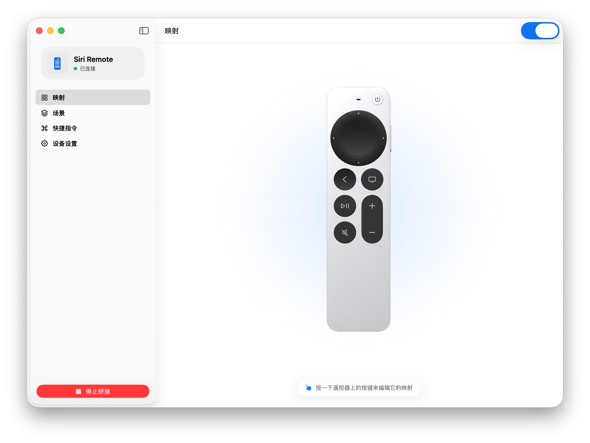
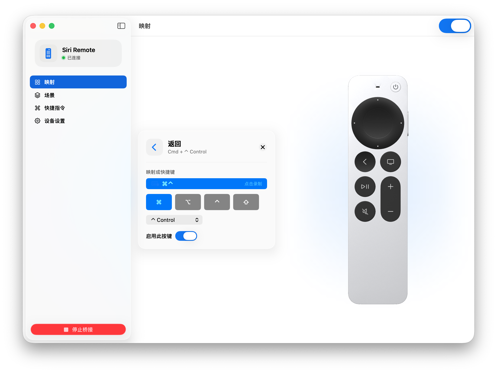
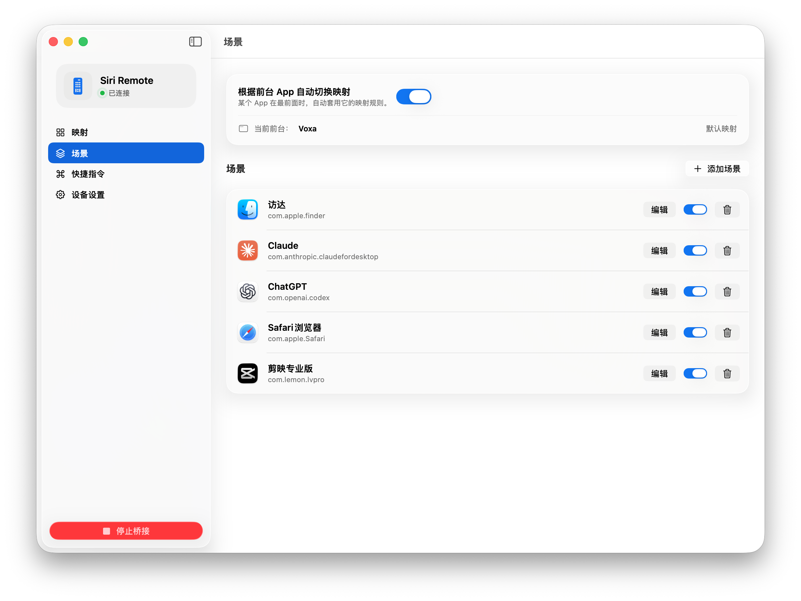

# VOXA

[English](./README.md) · **简体中文**

> 把 Apple TV Siri Remote 变成顺手的 Mac 遥控输入设备。

[-007AFF)](https://github.com/jinzongma/voxa/releases/latest)

VOXA 支持遥控器按键映射、触控操作、快捷指令和按前台 App 自动切换场景。麦克风版还可以将支持的 Siri Remote 内置麦克风作为 Mac 的音频输入设备。

## 下载

**[下载 VOXA 1.3.0（Build 89）](https://github.com/jinzongma/voxa/releases/latest)**

- 支持 Apple Silicon Mac
- 需要 macOS 13 Ventura 或更高版本
- 需要先在 macOS 蓝牙设置中配对 Apple TV Siri Remote
- 安装包已使用 Developer ID 签名并通过 Apple 公证

详细步骤请查看 [安装与使用教程](./VOXA-User-Guide.zh-CN.md)。

## 功能亮点

- **自由映射**：把遥控器按键映射为键盘按键、组合键或常用操作。
- **场景切换**：根据当前前台 App 自动应用不同的映射方案。
- **触控与圆环**：使用触控板和外圈完成鼠标、滚动或 App 切换操作。
- **快捷指令**：直接查看并运行 macOS“快捷指令”。
- **麦克风输入**：麦克风版支持将兼容的 Siri Remote 用作 Mac 麦克风。

## 界面预览

### 遥控器映射

### 自定义按键

### App 场景

## 贡献者

- [Pupa2000](https://github.com/Pupa2000)
- Codex（OpenAI）
- Claude（Anthropic）

## 联系方式

如有问题或建议，请发送邮件至 [huabeijinzongma@icloud.com](mailto:huabeijinzongma@icloud.com)。
