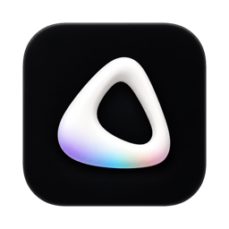
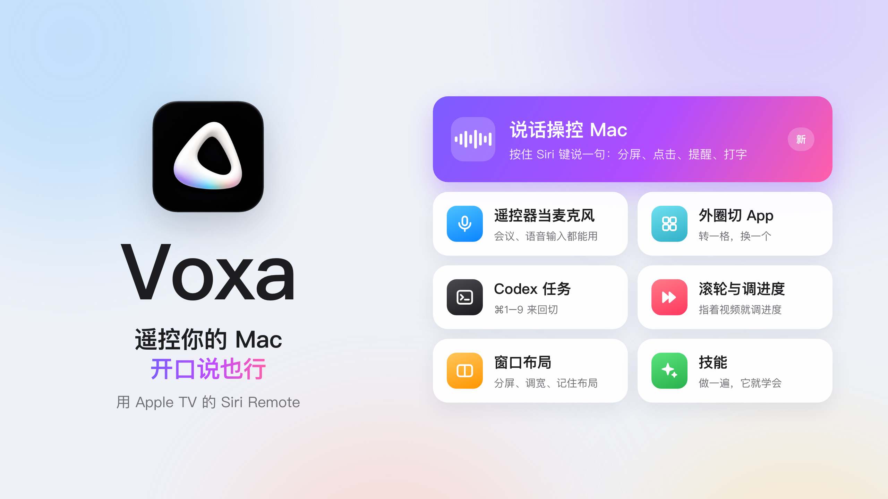

[English](./README.md) | **简体中文**

# Voxa：用 Apple TV 遥控器控制 Mac，支持语音操控

把**苹果电视遥控器**（Siri Remote）变成 Mac 遥控器：按一下、滑一下、转外圈， 
或者按住 Siri 键，**直接说你要做什么**。

**[下载 Mac 版 Voxa（.dmg）](https://github.com/jinzongma/apple-tv-remote-for-mac/releases/latest)** · [官网](https://voxa.saitosun.cn) · [使用教程](./VOXA-User-Guide.zh-CN.md)

**Voxa** 是一款 macOS 应用，把 **Apple TV 遥控器**（Siri Remote）变成 **Mac 遥控器**：按键映射成快捷键、触控板当鼠标、
转外圈切换 App、给 Keynote 和 PPT 当**翻页笔**，开通 Voice Pro 后还能借遥控器上的麦克风**用语音操控 Mac**。
在蓝牙设置里配对好遥控器就能用，不需要 Apple TV。

## 语音操控

按住 Siri 键，说一句，松手，Voxa 就在 Mac 上帮你做完：

| 你说 | Voxa 做什么 |
| --- | --- |
| “把微信和备忘录左右分屏” | 两个窗口左右排好 |
| “记住这个布局，叫写作” | 记下现在的窗口布局，以后一句话恢复 |
| “点一下发送” | 找到叫「发送」的按钮点下去 |
| “提醒我今晚八点给妈妈打电话” | 添加一条提醒 |
| “明天下午三点开会，加到日历” | 添加一个日程 |
| “给张三发微信说晚点到” | 发一条微信 |
| “截个图” · “声音小一点” | 截图 · 调小音量 |

- **一句话里有几步也行**：Voxa 会拆开，按顺序做完。
- **帮你打字**：说的话直接打进任意输入框。
- **技能**：做一遍给 Voxa 看，以后一句话就照着做。

> 语音操控属于 **Voice Pro**（一次性购买），目前在 Voxa 的语言设为简体中文时可用，需要 macOS 14 Sonoma 或更高版本。
> 语音在 Mac 本机识别。

## 遥控 Mac（免费）

- **按键映射**：把 Siri Remote 上的任意按键映射成键盘按键、组合快捷键或常用操作。
- **App 场景**：每个 App 用一套映射，切到前台时自动生效（比如在 Keynote 里翻页、在播放器里暂停）。
- **触控板当鼠标**：坐在沙发上用遥控器移动指针、点击。
- **外圈切换 App**：转一格，换一个 App。
- **快捷指令**：直接查看并运行 macOS「快捷指令」。
- **长按模式**：按住 Siri 键多久，映射的键就按住多久，适合「按住说话、松手结束」的语音输入法。
- **开机自动启动**：Mac 一开机遥控器就能用，安静地待在菜单栏。

## Voice Pro 还包括

- **遥控器当 Mac 麦克风**：兼容的 Siri Remote 会作为「Voxa Microphone」出现，开会、语音输入法、录音软件都能选它。
- **更多外圈用法**：滚动网页、切换 Codex 任务（⌘1–9），指针停在视频上时转外圈调进度。

## 下载

**[下载最新版 Voxa（.dmg）](https://github.com/jinzongma/apple-tv-remote-for-mac/releases/latest)**

- Apple Silicon Mac（M1 及更新机型）
- macOS 13 Ventura 或更高版本（语音操控需要 macOS 14 Sonoma 或更高版本）
- Apple TV Siri Remote 已在「系统设置 › 蓝牙」中配对
- 安装包已使用 Developer ID 签名并通过 Apple 公证

详细步骤请看 [安装与使用教程](./VOXA-User-Guide.zh-CN.md)。

## 界面预览

### 遥控器映射

### 自定义按键

### App 场景

## 常见问题

**能用遥控器语音控制 Mac 吗？**
可以（Voice Pro）：按住 Siri 键说话即可。目前在 Voxa 的语言设为简体中文时可用，需要 macOS 14 或更高版本。

**Apple TV 遥控器（Siri Remote）能控制 Mac 吗？**
可以。在「系统设置 › 蓝牙」里配对遥控器，Voxa 就会把按键、触控板和外圈变成 Mac 的操作。不需要 Apple TV。

**Siri Remote 能当 Keynote / PPT 翻页笔吗？**
可以。把按键或外圈映射成上一页、下一页；配合 App 场景，打开演示软件时自动切换到翻页映射。

**Siri Remote 的麦克风能在 Mac 上用吗？**
开通 Voice Pro 后，兼容的 Siri Remote 会成为一个名叫「Voxa Microphone」的输入设备，任何 App 都能选它。

**支持 Intel Mac 吗？**
不支持，Voxa 只支持 Apple Silicon Mac。

**是订阅制吗？**
不是。遥控器的基础功能免费；Voice Pro 是一次性购买。

**我的语音会上传吗？**
语音在 Mac 本机识别，声音不会上传；需要理解较复杂的指令时，只会把识别出的文字发给 Voxa 的 AI 服务。

## 贡献者

- [Pupa2000](https://github.com/Pupa2000)
- Codex（OpenAI）
- Claude（Anthropic）

## 联系方式

如有问题或建议，请发送邮件至 [huabeijinzongma@icloud.com](mailto:huabeijinzongma@icloud.com)。
